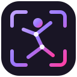
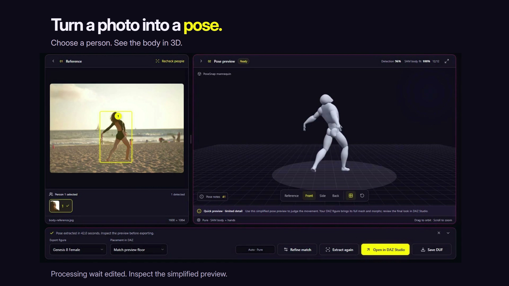

# PoseSnap

**A moment. A pose. Yours.**

Turn photos and words into editable Genesis poses—on your own PC.

[**Download for Windows x64 · v1.0.1**](https://github.com/AithaEzio/PoseSnap/releases/download/v1.0.1/PoseSnap-1.0.1-Windows-x64.zip) · [Watch the launch film](#watch-posesnap) · [Get started](#get-started) · [Technical guide](#under-the-hood)

**Windows x64 · Local processing · Genesis 8 & 9 · Source available**

PoseSnap helps you build a starting pose, refine its joints and bring it into DAZ Studio. Extract a person from a photograph, arrange two people, capture a facial expression or describe a body pose in words. Inspect the result before applying it.

## Watch PoseSnap

The complete 100-second launch film. Sound is optional. Waiting intervals were edited; this is a feature demonstration, not a speed benchmark.

https://github.com/user-attachments/assets/a85fcd09-58cc-46c7-b85b-56ad5f204716

[Download the original 1080p film](https://github.com/AithaEzio/PoseSnap/releases/download/v1.0.1/PoseSnap-Launch-1080p.mp4) · [Captions](docs/media/captions.vtt) · [Transcript and media credits](docs/MEDIA-CREDITS.md)

## Get started

1. **Download the Windows ZIP.** Choose the named Windows-x64.zip, not GitHub's automatic Source code archives.
2. **Extract into a new, writable NTFS folder.** Open **PoseSnap.exe** and keep the whole folder together. Private WebView2 is included.
3. **Set up your engines.** Open **Settings → Engine**, choose **Pose + Expression** or **All modes**, then click **Set up PoseSnap**. Leave the app open while it downloads, verifies and installs the components.
4. **Create and inspect.** Open, drop or paste a reference photo, or visit Text to Pose. Preview the result, refine it in Studio, then use **Open in DAZ Studio** or **Save DUF**.

No account, API key, subscription, system Python or terminal command is needed for ordinary app setup. Required engines have download sources; Pause/retry preserves checked resumable parts. After installation, image processing and generation run locally.

**Body connections are optional.** Built-in rigs support Genesis 8 Female, Genesis 8 Male and Genesis 9. Connect a selected figure only when you want to read its compatible rig metadata. Expression export uses a separate facial connection so PoseSnap can discover the available controls.

## From a photograph to a pose

Open your image and choose a numbered person. **Auto** selects **Pure** for individual extraction and **Genesis Smart Fit** for Arrange interaction. You can also choose a method explicitly.

Smart Fit's **Zero cropped joints** option starts eligible joints outside the photograph at neutral. It is on by default, applies to the next extraction and leaves genuinely occluded anatomy inside the image estimated. Pure remains a separate method.

https://github.com/user-attachments/assets/b180cfb8-381e-4bdc-9fa2-2142c0ff1839

## Two people. One shared pose.

Choose the people and their Genesis generations in **Arrange interaction**. Build a shared layout, then inspect each figure and their contact points in Pose Studio. Character scale stays untouched.

**Partner contacts and hidden depth remain experimental estimates.** Check palms, feet and spacing from the side, particularly with overlapping or cropped people.

https://github.com/user-attachments/assets/5c93acd5-61f9-4615-8ecd-42e3ff7e757a

## Make the pose your own

In **Pose Studio**, select a body part and adjust its joints. Use grouped joint search, numeric controls, movement/rotation tools, position and rotation pins, zeroing, facing and floor controls. Undo helps you explore and return to an earlier edit. Save local drafts and restore them from History.

https://github.com/user-attachments/assets/1bc34f21-d9f2-4e65-a42e-33676fa352bb

## Capture an expression

In **Expression Studio**, select a face and extract its expression locally. Compare with neutral, adjust strength and fine-tune facial regions, eyelids, gaze, cheeks and visible tongue estimates. Connect the matching DAZ face to discover which movements it supports.

Hidden facial detail, strong occlusion and extreme head angles can need manual correction. The preview is an adapted face, not your Genesis figure's own shape.

https://github.com/user-attachments/assets/170a9364-b1a4-443c-ad66-060a8b93a259

## Describe a body pose

**Text to Pose** uses Kimodo. Describe a person, the main stance or action, and a few defining body details. For example:

> A person stands confidently with weight on the right leg, the left knee relaxed, the right hand at the hip and the left arm resting naturally at the side.

Explore up to three valid alternatives, choose **More like this**, then Apply and refine the accepted result in Pose Studio. Optional pose-character profiles help describe the body language. Use the in-app **Prompt guide** for examples and a reusable LLM prompt-writing skill.

**This mode generates body poses, not facial expressions or props.** Approximate hand shapes is optional and off by default. Detailed instructions are goals, not exact joint guarantees; use Studio for precision. Fully constrained requests may return fewer choices.

https://github.com/user-attachments/assets/14df7f46-8ad9-4698-be41-00fc438492ba

## Save it. Return to it.

Local History and Studio drafts keep useful results within reach. Restore a previous result, inspect it and continue editing. Deleting app-managed history does not delete your original imported photograph.

https://github.com/user-attachments/assets/7415b7f6-e528-40a2-b11c-8bb40a5912a7

## What do I need?

| Use | Requirements |
|---|---|
| Open the portable workspace | Windows x64, writable local/external NTFS folder; private browser included |
| Extract body poses | Supported NVIDIA GPU/driver; the app requires at least 8 GB VRAM |
| Kimodo Text to Pose | NVIDIA GPU with at least 4 GiB free VRAM and about 10 GiB free system RAM for the CPU text encoder |
| Facial extraction | Optional local MediaPipe expression component and private runtime; facial analysis runs on CPU |
| Direct DAZ application | Matching supported Genesis figure selected in DAZ Studio; facial export needs its facial connection |

The development machine used an RTX 5070 Ti with 16 GB VRAM. That is not a certification of every other configuration. Close unused GPU-heavy applications if memory is tight.

| Setup | Additional engine download | Approximate installed total |
|---|---:|---:|
| Portable core | ZIP about 306 MiB | 687 MiB |
| Pose + Expression | 7.49 GB | 13.5 GB |
| All modes, including Kimodo | 16.77 GB | 22.8 GB |

Allow extra temporary space for downloads and safe replacement. The app displays current component sizes. **CLUE is optional and off by default**; its separately authorised diagnostic files are not required for normal extraction or generation.

## Your work stays local

Photos, settings, history, cached inference and connected rig metadata stay in the portable folder. Setup downloads components; your input photographs are not uploaded for processing. Move the whole folder while the app is closed. Explicit exports go where you choose.

Before updating, back up your own **data** folder and preserve the previous working installation. Extract updates separately instead of merging versions. Retry failed component downloads in Engine settings; offline import is available for recovery. **PoseSnap.exe --engine-setup** opens private-browser repair.

## Can I use it commercially?

**Yes: use PoseSnap for your creative work, commissions and commercial pose packs.** PoseSnap requires no royalty or credit on your creative outputs. Credit is welcome.

The application code has different rules: noncommercial software distributions retain attribution and provide corresponding source; commercial app/code redistribution and commercial hosted generation require separate permission. See [the licence](LICENSE). This is **source-available software**, not an OSI open-source licence. Upstream models, artwork and your input materials retain their own terms.

[Download the reviewed application-source snapshot](https://github.com/AithaEzio/PoseSnap/releases/download/v1.0.1/PoseSnap-Source-v1.0.1.zip) · [Developer instructions](docs/DEVELOPING.md)

## Under the hood

<strong>Architecture, fitting and safeguards</strong>

The desktop shell uses **Tauri 2 and Rust**, with **Svelte 5, TypeScript and Three.js** for the interface and previews. The native layer manages the private browser, pinned component installation and a separately launched Python worker. Models load when needed rather than being bundled into the small core.

- **Photos:** person detection and ownership checks precede SAM 3D Body/MHR reconstruction. Pure transfers the estimated pose to the chosen Genesis rig. Smart Fit adds observed body/hand/foot measurements, camera-aware fitting and bounded target optimisation. Interactions coordinate placement and contact objectives across owned actors.
- **Expressions:** local MediaPipe landmark/blendshape analysis runs off the UI thread. Selected-face ownership and orientation handling precede semantic facial retargeting. Supported channels depend on the connected figure; uncertain detail and unsupported channels remain visible in notes.
- **Text:** a **Llama-3-Kimodo Q8 CPU text encoder** feeds NVIDIA's **Kimodo-SOMA-RP-v1.2 CUDA motion generator**. PoseSnap selects static poses and fits them to Genesis. It does not export generated animation or use Qwen.
- **Editing and export:** the accepted result is distinct from a pending preview. Studio edits, Apply/Cancel, undo and export use the accepted actor and rig. Scale, identity and unrelated controls are intended to remain unchanged. Pins and confirmed contacts are weighted constraints; unresolved gaps must be reviewed rather than assumed exact.

Caches separate source inference from target fitting and include image, model, preprocessing and relevant stage-code identity. Target-only changes should not force compatible raw image inference to run again. Pending refinement checks include pins, camera/crop context and fitting-policy identity; accepted legacy history remains readable.

**Visible 2D fit is image-space agreement, not 3D accuracy.** Read coverage alongside the score. Missing landmarks are excluded, and many hand points must not be confused with complete body evidence. A high fit cannot validate invisible anatomy, physical partner distance or a side view. CLUE estimates uncertainty in the initial body prior, not final-pose accuracy. MoGe spacing cues remain learned depth evidence, not guaranteed metric distances.

See [the technical and development guide](docs/DEVELOPING.md) for runtime boundaries and reproducibility limits.

<strong>Validation and current boundaries</strong>

The local 5 November 2026 repair build passed **330 frontend, 321 worker and 50 native tests**; two opt-in native checks were not run. Its ZIP member hashes, version agreement and source/compiler-path privacy checks passed. A corrected clean-copy native check verified startup, recovery messages, version, Text engine status and clean exit without changing original user settings.

These are distinct evidence classes. The full photographic neural-quality suite and live DAZ behaviour were not requalified in that pass. Floor and partner-contact workflows retain experimental labels. The unsigned Windows release and other hardware/native-DPI configurations have corresponding limits. Runtime-ready badges describe health, not model-quality certification.

Use the [release checksum](https://github.com/AithaEzio/PoseSnap/releases/tag/v1.0.1) and the manifest inside the Windows ZIP for the exact uploaded package. The public source snapshot excludes private evaluation data and is not a promise that every private test can run without its fixtures.

## Credits

**Built with Meta Llama 3.** Thank you to NVIDIA Kimodo, Meta SAM 3D Body/DINOv3/MHR/SAM 2, Microsoft MoGe, Google MediaPipe and the other model/framework contributors. Their licences remain separate from PoseSnap's licence. [Complete component notices](THIRD_PARTY_NOTICES.md) · [Component licence bundle](https://github.com/AithaEzio/PoseSnap/releases/download/engines-20261026-v1/PoseSnap-Component-Licences-20261026.zip).

[Face Sculpting 108th (female)](https://sketchfab.com/3d-models/face-sculpting-108th-female-b6638e38d0b24ec7be39b578df25727b) by [ComputerCat](https://sketchfab.com/ComputerCats) · [CC BY 4.0](https://creativecommons.org/licenses/by/4.0/)

[Rigged Character by BLENDERJO](https://sketchfab.com/3d-models/rigged-character-6ead91e980434073bfb15799d3e674bb) · [CC BY 4.0](https://creativecommons.org/licenses/by/4.0/)

Adapted and rigged for PoseSnap’s preview. Genesis shapes may differ.

Photography, music and clip attribution are recorded in [media credits](docs/MEDIA-CREDITS.md). The people and artists shown do not endorse PoseSnap. DAZ Studio and Genesis belong to their respective rights holders; PoseSnap is an independent project.

## Support the creator

Made by **Aitha**. If PoseSnap helps your work, consider [supporting Aitha on Ko-fi](https://ko-fi.com/aithaezio) or [exploring Aitha's other projects](https://github.com/AithaEzio?tab=repositories).
